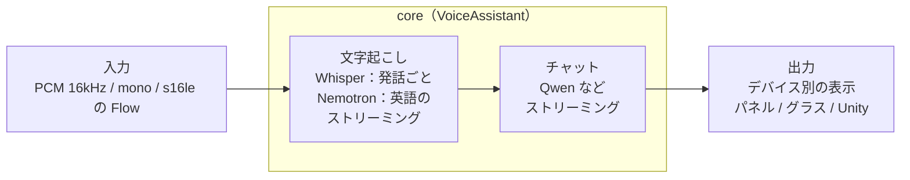

# Foundry Local XR

[English](README.md) | 日本語

[Foundry Local for Android](https://github.com/microsoft/FoundryLocalAndroid)（v0.1.6 Preview）を使って、XR デバイスでオンデバイスの「文字起こし＋会話」を動かすサンプル集です。
共通のコア（Kotlin）を 1 つ持ち、デバイスごとに音声の入力と表示の出力だけを差し替えています。



| モジュール | 対象 | 推論する場所 | 確認した環境 |
|---|---|---|---|
| `core/` | 共通コア（`VoiceAssistant`） | — | — |
| `app-panel/` | Galaxy XR / Quest 3 / スマホ（2D パネル） | デバイス本体 | Galaxy XR（embedded・ipc）、Quest 3（embedded） |
| `app-rokid/` + `app-rokid-glasses/` | Rokid Glasses（スマホのアプリ＋グラスの表示アプリ） | スマホ | RV101 ＋ ROG Phone 9 Pro（embedded・ipc） |
| `app-g2-companion/` + `g2-web/` | Even G2（スマホの companion アプリ＋Even Hub の Web アプリ） | スマホ（Android のみ） | G2 ＋ ROG Phone 9 Pro（embedded・ipc） |
| `unity-bridge/` + `unity-sample/` | Unity（MiRZA。Quest 3 / Galaxy XR の Unity アプリにも使える） | スマホ / デバイス本体 | MiRZA ＋ AQUOS R9（embedded） |

各モジュールの詳細は、それぞれの README を参照してください。

## 必要なもの

- JDK 17 以上
- Android SDK（compileSdk 37）
- [GitHub CLI](https://cli.github.com/)（SDK の取得に使用）
- 動作させる端末は Android 13（API 33）以上。Foundry Local for Android の minSdk が 33 のため

## セットアップ

Foundry Local for Android の AAR はリポジトリに含めていません。GitHub Releases から取得してください。

```powershell
libs\fetch-sdk.ps1          # AAR を GitHub Releases から取得し、SHA-256 を検証する
$env:JAVA_HOME = "<JDK 17 以上のパス>"
.\gradlew.bat :app-panel:assembleEmbeddedDebug   # Galaxy XR / Quest 3
.\gradlew.bat :app-panel:assembleIpcDebug        # Galaxy XR / スマホ（Foundry Local アプリが必要）
```

SDK のライセンスは、[microsoft/FoundryLocalAndroid の Releases](https://github.com/microsoft/FoundryLocalAndroid/releases) にあるライセンス文書を確認してください。

### embedded と ipc

各アプリには 2 つのフレーバーがあります。

| フレーバー | 推論エンジン | 向いている場面 |
|---|---|---|
| `embedded` | APK に同梱（ABI ごとに約 70MB） | Play ストアの無い端末（Quest 3 など）、単体のアプリで配布したい場合 |
| `ipc` | Play ストアの Foundry Local アプリを使う | 複数のアプリでローカル LLM を使う場合 |

- ipc では、複数のアプリが同時に接続すると、Foundry Local アプリの中でアプリごとに分けて実行され、モデルも別々にダウンロードされます。順番に使う場合は、モデルを共有します。
- ipc フレーバーは、アプリ名に「(IPC)」、applicationId に `.ipc` が付きます。embedded 版と並べてインストールできます。
- エミュレータ向けには `-PabiFilter=x86_64` を付けると APK が小さくなります。

### 起動オプション（app-panel）

`adb shell am start -n com.example.flxr.panel/.MainActivity` に次のオプションを付けて起動できます。

| オプション | 内容 |
|---|---|
| `--es mode en` | 英語ストリーミング（Nemotron）で起動する |
| `--es asr openai-whisper-base` | 文字起こしのモデルを指定する（ID の前方一致） |
| `--es chat qwen2.5-0.5b` | チャットのモデルを指定する（ID の前方一致） |

## 実測

### Galaxy XR（SM-I610、Android 14）

WAV ファイルをマイクの代わりに実時間で入力して計測しました。発話は 1.5 秒 / 3.4 秒 / 2.7 秒の 3 つです。

| 音声モデル | 1 発話の文字起こし時間 | 認識結果 |
|---|---|---|
| whisper-small | 3.7〜5.2 秒 | 正確 |
| **whisper-base** | **1.3〜2.0 秒** | 正確（句点付き） |
| whisper-tiny | 0.76〜0.78 秒 | 「XR」→「エクサール」の誤り |

| 項目 | 結果 |
|---|---|
| モデルの取得（Wi-Fi） | whisper-small 48 秒 / qwen2.5-1.5b 3 分 15 秒 / Nemotron en 1 分 34 秒 |
| 起動（キャッシュ済み） | ランタイムとモデル 2 つの読み込みで約 10 秒 |
| チャットの応答（qwen2.5-1.5b） | 1〜4 秒 |
| 英語ストリーミング（Nemotron） | 7.5 秒の音声を 3.4 秒で処理（実時間の 0.45 倍）。「Hello」は話し終わりから約 1.7 秒で確定 |

ヘッドセットでは、whisper-base が速度と精度のバランスがよい結果でした。

### Android XR エミュレータ（x86_64、RAM 4GB）

| 項目 | 結果 |
|---|---|
| カタログ | 47 モデル（Whisper tiny〜large-v3-turbo、Nemotron、Qwen2.5/3/3.5、Phi-4-mini など。すべて CPU） |
| モデルの取得 | whisper-small 438MB: 73 秒 / qwen2.5-1.5b 1.8GB: 4.5 分 |
| 発話の終わり → 文字起こしの確定 | 約 1〜2 秒 |
| チャットの応答（qwen2.5-1.5b、日本語） | 1〜3 秒 |

## 既知の制約

- NPU / GPU は使われません（AAR に含まれるのは CPU 用のランタイムのみ）。
- Nemotron のストリーミングは英語専用です。日本語は Whisper を発話ごとに実行するため、文字が出るのは話し終わってからです。
- モデル ID はリリースによって変わる可能性があるため、`AssistantConfig` の候補リスト（前方一致）とキーワードで解決しています。
- `app-panel` の `-PminSdkOverride=<API レベル>` は、minSdk 33 未満の端末で試すための実験用のオプションです。Foundry Local for Android のサポート対象外の使い方で、動作は保証されません。

## ライセンス

このリポジトリのコードは [Boost Software License 1.0](LICENSE)（SPDX: `BSL-1.0`）で公開しています。

Foundry Local for Android（`foundry-local-embedded-sdk` / `foundry-local-ipc-sdk`）は Microsoft が独自のライセンスで提供しているもので、このリポジトリのライセンスの**対象外**です。AAR はこのリポジトリに含めていません。`libs/fetch-sdk.ps1` が [microsoft/FoundryLocalAndroid の Releases](https://github.com/microsoft/FoundryLocalAndroid/releases) から、ライセンス文書と一緒に取得します。SDK を同梱した APK や AAR を再配布する場合は、そのライセンスの条件を確認してください。実行時にダウンロードするモデルも、それぞれ独自のライセンスを持っています。
