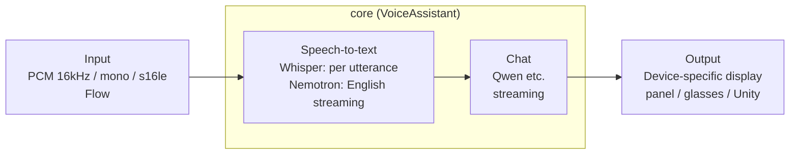

# Foundry Local XR

English | [日本語](README.ja.md)

Samples that run on-device "speech-to-text + chat" on XR devices using [Foundry Local for Android](https://github.com/microsoft/FoundryLocalAndroid) (v0.1.6 Preview).
They share a single core (Kotlin); each device swaps out only the audio input and the display output.

> **Note:** The apps' UI and log messages are in Japanese. The READMEs quote on-screen text in Japanese with an English gloss, e.g. `準備完了` ("Ready").



| Module | Target | Where inference runs | Tested on |
|---|---|---|---|
| `core/` | Shared core (`VoiceAssistant`) | — | — |
| `app-panel/` | Galaxy XR / Quest 3 / phone (2D panel) | On the device itself | Galaxy XR (embedded, ipc), Quest 3 (embedded) |
| `app-rokid/` + `app-rokid-glasses/` | Rokid Glasses (phone app + glasses display app) | Phone | RV101 + ROG Phone 9 Pro (embedded, ipc) |
| `app-g2-companion/` + `g2-web/` | Even G2 (phone companion app + Even Hub web app) | Phone (Android only) | G2 + ROG Phone 9 Pro (embedded, ipc) |
| `unity-bridge/` + `unity-sample/` | Unity (MiRZA; also usable from Unity apps on Quest 3 / Galaxy XR) | Phone / on the device itself | MiRZA + AQUOS R9 (embedded) |

See each module's README for details.

## Requirements

- JDK 17 or later
- Android SDK (compileSdk 37)
- [GitHub CLI](https://cli.github.com/) (used to fetch the SDK)
- Target devices must run Android 13 (API 33) or later, because the minSdk of Foundry Local for Android is 33

## Setup

The Foundry Local for Android AAR is not included in this repository. Fetch it from GitHub Releases.

```powershell
libs\fetch-sdk.ps1          # Fetch the AAR from GitHub Releases and verify its SHA-256
$env:JAVA_HOME = "<path to JDK 17 or later>"
.\gradlew.bat :app-panel:assembleEmbeddedDebug   # Galaxy XR / Quest 3
.\gradlew.bat :app-panel:assembleIpcDebug        # Galaxy XR / phone (requires the Foundry Local app)
```

For the SDK license, see the license documents in the [microsoft/FoundryLocalAndroid Releases](https://github.com/microsoft/FoundryLocalAndroid/releases).

### embedded and ipc

Each app has two flavors.

| Flavor | Inference engine | Best suited for |
|---|---|---|
| `embedded` | Bundled in the APK (about 70MB per ABI) | Devices without the Play Store (such as Quest 3), or when you want to distribute a single standalone app |
| `ipc` | Uses the Foundry Local app from the Play Store | When multiple apps use a local LLM |

- With ipc, when multiple apps connect at the same time, the Foundry Local app runs each app separately and downloads the models separately for each. When the apps are used one after another, the models are shared.
- The ipc flavor appends "(IPC)" to the app name and `.ipc` to the applicationId, so it can be installed side by side with the embedded build.
- For emulators, add `-PabiFilter=x86_64` to make the APK smaller.

### Launch options (app-panel)

You can launch `adb shell am start -n com.example.flxr.panel/.MainActivity` with the following options.

| Option | Description |
|---|---|
| `--es mode en` | Start in English streaming mode (Nemotron) |
| `--es asr openai-whisper-base` | Specify the speech-to-text model (prefix match on the ID) |
| `--es chat qwen2.5-0.5b` | Specify the chat model (prefix match on the ID) |

## Measurements

### Galaxy XR (SM-I610, Android 14)

Measured by feeding a WAV file in real time in place of the microphone. The input contains three utterances of 1.5 s / 3.4 s / 2.7 s.

| Speech model | Transcription time per utterance | Recognition result |
|---|---|---|
| whisper-small | 3.7–5.2 s | Accurate |
| **whisper-base** | **1.3–2.0 s** | Accurate (with sentence-ending punctuation) |
| whisper-tiny | 0.76–0.78 s | Misrecognized "XR" as 「エクサール」 ("ekusāru") |

| Item | Result |
|---|---|
| Model download (Wi-Fi) | whisper-small 48 s / qwen2.5-1.5b 3 min 15 s / Nemotron en 1 min 34 s |
| Startup (cached) | About 10 s to load the runtime and two models |
| Chat response (qwen2.5-1.5b) | 1–4 s |
| English streaming (Nemotron) | Processed 7.5 s of audio in 3.4 s (0.45x real time). "Hello" was finalized about 1.7 s after the speaker stopped |

On the headset, whisper-base gave the best balance of speed and accuracy.

### Android XR emulator (x86_64, 4GB RAM)

| Item | Result |
|---|---|
| Catalog | 47 models (Whisper tiny to large-v3-turbo, Nemotron, Qwen2.5/3/3.5, Phi-4-mini, etc. All CPU) |
| Model download | whisper-small 438MB: 73 s / qwen2.5-1.5b 1.8GB: 4.5 min |
| End of utterance → transcription finalized | About 1–2 s |
| Chat response (qwen2.5-1.5b, Japanese) | 1–3 s |

## Known limitations

- NPU / GPU are not used (the AAR contains only the CPU runtime).
- Nemotron streaming is English-only. For Japanese, Whisper runs per utterance, so text appears only after you finish speaking.
- Model IDs may change between releases, so they are resolved using the candidate lists (prefix match) and keywords in `AssistantConfig`.
- `-PminSdkOverride=<API level>` for `app-panel` is an experimental option for trying the app on devices below minSdk 33. This usage is not supported by Foundry Local for Android, and operation is not guaranteed.

## License

The code in this repository is licensed under the [Boost Software License 1.0](LICENSE) (SPDX: `BSL-1.0`).

Foundry Local for Android (`foundry-local-embedded-sdk` / `foundry-local-ipc-sdk`) is provided by Microsoft under its own license and is **not** covered by this repository's license. The AARs are not included in this repository. `libs/fetch-sdk.ps1` downloads them, together with the license document, from the [microsoft/FoundryLocalAndroid Releases](https://github.com/microsoft/FoundryLocalAndroid/releases). Check the terms of that license before redistributing an APK or AAR that bundles the SDK. The same applies to the models you download at runtime, which have their own licenses.
