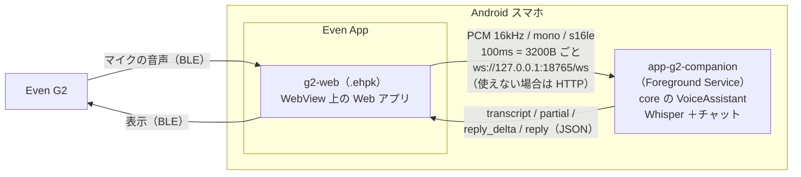

# app-g2-companion — Even Realities G2

[English](README.md) | 日本語

Even G2 のマイクの音声を、同じ Android スマホの上の Foundry Local で文字起こしして返事を作り、結果を G2 に表示するサンプルです。



- G2 のアプリは、Even App の中の WebView で動く Web アプリ（Even Hub）として作ります。ネイティブの SDK はありません。そこで Foundry Local は companion アプリ側に置き、WebView からは loopback（127.0.0.1）だけで通信します。
- **iOS では動きません。** Foundry Local for Android を載せた companion アプリを同じ端末で常駐させる必要があるため、Android の Even App でのみ成り立つ構成です。

| パス | 内容 |
|---|---|
| `app-g2-companion/` | Android アプリ（`com.example.flxr.g2companion`）。Foreground Service が `VoiceAssistant` とサーバを持つ |
| `app-g2-companion/.../server/` | Android に依存しないサーバ部分（`SessionHub` / `CompanionServer` / `PcmFramer`）。JVM のユニットテストの対象 |
| `g2-web/` | Even Hub の Web アプリ（Vite + TypeScript、`@evenrealities/even_hub_sdk` 0.0.10） |

## ビルド

```powershell
.\gradlew.bat :app-g2-companion:assembleEmbeddedDebug      # APK（Foundry Local のランタイムを同梱）
.\gradlew.bat :app-g2-companion:assembleIpcDebug           # APK（Play ストアの Foundry Local アプリを使う）
.\gradlew.bat :app-g2-companion:testEmbeddedDebugUnitTest  # サーバのユニットテスト

cd g2-web
npm install
npm run pack            # → g2-web/flxr-g2.ehpk
```

## 使い方

1. スマホに companion アプリの APK を入れます。
2. **FLXR G2 Companion** を開いて「サービス開始」を押します。通知の許可を求められたら許可し、「電池最適化を除外」も押してください。初回はモデルのダウンロードがあるので、「準備完了」になるまで待ちます。
3. G2 の Web アプリを Even App で開きます。
   - 開発中：`cd g2-web; npm run dev` で起動し、`npx evenhub qr --url http://<PC の IP アドレス>:5173` で表示される QR コードを Even App で読み取ります。
   - パッケージ：`npm run pack` で作った `flxr-g2.ehpk` を Even Hub にアップロードして起動します。
4. G2 に「話しかけてください」と表示されたら、そのまま話しかけます。G2 に「あなた: …」「AI: …」が表示されます。
   - タップ：マイクの一時停止と再開（話の途中なら、そこで発話を確定して返事を作ります）
   - ダブルタップ：終了

companion アプリが動いていないときは、G2 にその旨が表示され、起動すると 5 秒以内に自動で再接続します。

## プロトコル

ポートは 18765 で固定しています（`app.json` の `network.whitelist` に書くため）。待ち受けるのは `127.0.0.1` だけです。

| エンドポイント | 用途 |
|---|---|
| `GET /health` | 疎通確認。`{"ok":true,"service":"flxr-g2-companion","ready":..,"status":..,"origin":<呼び出し元の Origin>, ...}` |
| `WS /ws` | 上り：バイナリ = PCM、テキスト = JSON の制御メッセージ。下り：JSON のイベント |
| `POST /api/pcm` | HTTP フォールバックの上り（body = PCM。Content-Type なしで、プリフライトが発生しない） |
| `POST /api/control` | HTTP フォールバックの制御（body = JSON。`text/plain` で送り、プリフライトが発生しない） |
| `GET /api/events?after=<seq>&wait=<ms>` | HTTP フォールバックの下り（ロングポーリング、最大 25 秒） |

制御メッセージ（クライアント → サーバ）：`{"type":"start"}` / `{"type":"stop"}`（今の発話を確定させる）/ `{"type":"ask","text":"..."}`（テキストで質問）/ `{"type":"ping"}` / `{"type":"status"}`。
最初の PCM が届いた時点で聞き取りを始めるので、`start` は省略できます。

イベント（サーバ → クライアント、すべて `seq` 付き）：

| type | 内容 |
|---|---|
| `hello` | 接続した直後の状態（WebSocket のみ） |
| `status` | `ready` / `listening` / `status` / `error` / `models` / `audioOpen` |
| `partial` | 文字起こしの途中経過（Whisper では処理中を示す `…`。空文字で解除） |
| `transcript` | 確定した発話 |
| `reply_delta` / `reply` | 返事のストリーミングの差分 / 確定した全文 |
| `error` / `ack` / `pong` | 制御メッセージへの応答 |

サーバ側の動作：

- 受け取った PCM は `PcmFramer` で 3200B（100ms）単位に切り直してから core に渡します。core の `EnergyVad` がチャンクの長さから時間を計算するためです。
- PCM は 1 本のチャンネル（60 秒分。あふれたら古いものから捨てる）で `VoiceAssistant.startListening` に渡します。`stop`、最後の WebSocket の切断、HTTP で 20 秒間音声が来ない、のいずれかでチャンネルを閉じ、残りの発話を確定させます。
- モデルの準備ができる前に届いた音声はためておき、準備ができてから処理します。

## 設計メモ

### Ktor（server CIO）を使う理由

- WebSocket と HTTP を 1 つの軽いエンジン（CIO）で扱え、コルーチンと Flow をそのまま使えます。受け取ったフレームを `Channel` → `Flow<ByteArray>` に流すだけで core の API につながります。
- 同じ Ktor のクライアントで、JVM のユニットテストから実際のソケット越しにサーバを試せます。
- CORS は自前の小さなプラグイン（`loopbackCors`）で処理しています。`Origin` をそのまま `Access-Control-Allow-Origin` に返し、プリフライトには `Access-Control-Allow-Private-Network: true` も付けます。

### セキュリティ

待ち受けは 127.0.0.1 だけなので、LAN からは届きません。ただし、同じスマホのブラウザで開いたページからも 127.0.0.1:18765 に届くため、初期設定ではすべての Origin を許可しています（できるのはローカル LLM に話しかけることだけです）。
Origin を絞りたい場合は、`CompanionServer(originAllowed = { it == null || it.startsWith("http://127.0.0.1:") })` のように渡してください。パッケージ版の `.ehpk` は `http://127.0.0.1:<ランダムなポート>` から配信されます。

## うまく接続できないとき

- Even App で開いたページ（スマホの画面）の「診断」欄に、`pageOrigin` / `diagnosis` / `transport` などが表示されます。G2 にも原因（companion が起動していない、接続を拒否された、CORS や whitelist で拒否された、タイムアウト）が表示されます。
- WebSocket だけが使えない場合は、自動で HTTP フォールバックに切り替わります。手動で試すには「HTTP fallback で接続」ボタンを押すか、URL に `?transport=http` を付けます。
- companion アプリの画面の「最終 Origin」で、サーバに届いたリクエストの Origin を確認できます。
- ログは `adb logcat -s FLXR FLXR-G2` で確認できます。
