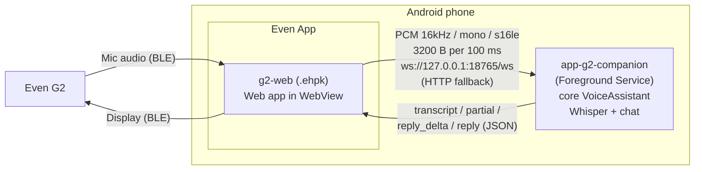

# app-g2-companion — Even Realities G2

English | [日本語](README.ja.md)

A sample that takes audio from the Even G2 microphone, runs speech-to-text and generates a reply with Foundry Local on the same Android phone, and shows the result on the G2.



- G2 apps are built as web apps (Even Hub) that run in a WebView inside the Even App. There is no native SDK. So Foundry Local lives in the companion app, and the WebView talks to it over loopback (127.0.0.1) only.
- **This does not work on iOS.** The companion app with Foundry Local for Android must stay resident on the same device, so this setup only works with the Android Even App.

| Path | Contents |
|---|---|
| `app-g2-companion/` | Android app (`com.example.flxr.g2companion`). A Foreground Service owns the `VoiceAssistant` and the server |
| `app-g2-companion/.../server/` | Android-independent server code (`SessionHub` / `CompanionServer` / `PcmFramer`). Covered by JVM unit tests |
| `g2-web/` | Even Hub web app (Vite + TypeScript, `@evenrealities/even_hub_sdk` 0.0.10) |

## Build

```powershell
.\gradlew.bat :app-g2-companion:assembleEmbeddedDebug      # APK (bundles the Foundry Local runtime)
.\gradlew.bat :app-g2-companion:assembleIpcDebug           # APK (uses the Foundry Local app from the Play Store)
.\gradlew.bat :app-g2-companion:testEmbeddedDebugUnitTest  # Server unit tests

cd g2-web
npm install
npm run pack            # → g2-web/flxr-g2.ehpk
```

## Usage

1. Install the companion app APK on the phone.
2. Open **FLXR G2 Companion** and tap `サービス開始` ("Start service"). Allow notifications when prompted, and also tap `電池最適化を除外` ("Exclude from battery optimization"). The first run downloads the model, so wait until the status shows `準備完了` ("Ready").
3. Open the G2 web app in the Even App.
   - During development: start it with `cd g2-web; npm run dev`, then scan the QR code shown by `npx evenhub qr --url http://<PC IP address>:5173` with the Even App.
   - Packaged: upload the `flxr-g2.ehpk` built with `npm run pack` to Even Hub and launch it.
4. When the G2 shows `話しかけてください` ("Please speak"), just start talking. The G2 shows `あなた: …` ("You: …") and `AI: …`.
   - Tap: pause / resume the microphone (if you are mid-utterance, the utterance is finalized and a reply is generated)
   - Double tap: exit

If the companion app is not running, the G2 says so; once you start it, the web app reconnects automatically within 5 seconds.

## Protocol

The port is fixed at 18765 (because it must be listed in `network.whitelist` in `app.json`). The server listens on `127.0.0.1` only.

| Endpoint | Purpose |
|---|---|
| `GET /health` | Health check. `{"ok":true,"service":"flxr-g2-companion","ready":..,"status":..,"origin":<caller's Origin>, ...}` |
| `WS /ws` | Upstream: binary = PCM, text = JSON control messages. Downstream: JSON events |
| `POST /api/pcm` | HTTP fallback upstream (body = PCM. No Content-Type, so no preflight is triggered) |
| `POST /api/control` | HTTP fallback control (body = JSON. Sent as `text/plain`, so no preflight is triggered) |
| `GET /api/events?after=<seq>&wait=<ms>` | HTTP fallback downstream (long polling, up to 25 seconds) |

Control messages (client → server): `{"type":"start"}` / `{"type":"stop"}` (finalize the current utterance) / `{"type":"ask","text":"..."}` (ask a question as text) / `{"type":"ping"}` / `{"type":"status"}`.
Listening starts as soon as the first PCM arrives, so `start` is optional.

Events (server → client, all carry a `seq`):

| type | Contents |
|---|---|
| `hello` | State right after connecting (WebSocket only) |
| `status` | `ready` / `listening` / `status` / `error` / `models` / `audioOpen` |
| `partial` | In-progress transcription (with Whisper, `…` indicates processing; an empty string clears it) |
| `transcript` | Finalized utterance |
| `reply_delta` / `reply` | Streaming delta of the reply / finalized full text |
| `error` / `ack` / `pong` | Responses to control messages |

Server behavior:

- Incoming PCM is re-chunked into 3200 B (100 ms) units by `PcmFramer` before being passed to core, because core's `EnergyVad` computes time from the chunk length.
- PCM is passed to `VoiceAssistant.startListening` through a single channel (60 seconds of audio; oldest data is dropped on overflow). The channel is closed and the remaining utterance finalized on any of: `stop`, the last WebSocket disconnecting, or no audio over HTTP for 20 seconds.
- Audio that arrives before the models are ready is buffered and processed once they are ready.

## Design notes

### Why Ktor (server CIO)

- A single lightweight engine (CIO) handles both WebSocket and HTTP, and coroutines and Flow can be used as-is. Incoming frames just flow into a `Channel` → `Flow<ByteArray>` to connect to the core API.
- The same Ktor client lets JVM unit tests exercise the server over a real socket.
- CORS is handled by a small custom plugin (`loopbackCors`). It echoes `Origin` back as `Access-Control-Allow-Origin` and also adds `Access-Control-Allow-Private-Network: true` to preflight responses.

### Security

The server listens on 127.0.0.1 only, so it is not reachable from the LAN. However, pages opened in a browser on the same phone can also reach 127.0.0.1:18765, so by default all Origins are allowed (all they can do is talk to the local LLM).
To restrict Origins, pass something like `CompanionServer(originAllowed = { it == null || it.startsWith("http://127.0.0.1:") })`. The packaged `.ehpk` is served from `http://127.0.0.1:<random port>`.

## Troubleshooting connections

- The `診断` ("Diagnostics") section of the page opened in the Even App (on the phone screen) shows `pageOrigin` / `diagnosis` / `transport` and more. The G2 also shows the cause (companion not running, connection refused, rejected by CORS or the whitelist, timeout).
- If only WebSocket is unavailable, it switches to the HTTP fallback automatically. To try it manually, tap the `HTTP fallback で接続` ("Connect via HTTP fallback") button or add `?transport=http` to the URL.
- The `最終 Origin` ("Last Origin") field in the companion app screen shows the Origin of requests that reached the server.
- Check logs with `adb logcat -s FLXR FLXR-G2`.
