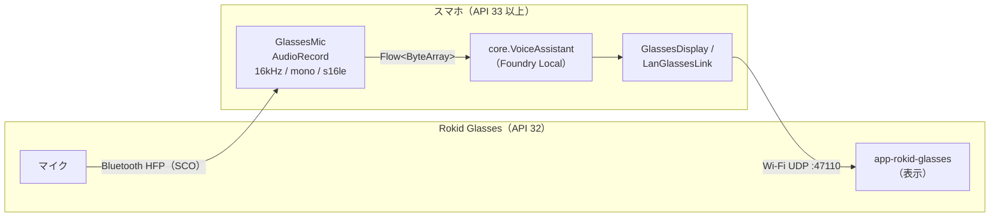

# app-rokid — Rokid Glasses（RV101）

[English](README.md) | 日本語

Rokid Glasses は OS が Android 12（API 32）で Foundry Local for Android の minSdk 33 を満たさず、RAM も 2GB しかありません。
そこで、スマホで推論し、グラスはマイクと表示だけを受け持つ構成にしています。



| モジュール | インストール先 | applicationId | 役割 |
|---|---|---|---|
| `app-rokid` | スマホ | `com.example.flxr.rokid`（ipc は `.ipc` 付き） | 推論、音声入力、グラスへの表示の送信 |
| `app-rokid-glasses` | グラス | `com.example.flxr.rokid.glasses` | 受け取ったテキストを表示する（minSdk 28 / targetSdk 32） |

## 仕組み

- **マイク**：グラスはスマホから Bluetooth ヘッドセット（HFP）として見えます。Android 標準の `AudioManager.setCommunicationDevice` で SCO の入力に切り替え、`AudioRecord` で 16kHz の PCM として録音します。Rokid の SDK は使いません。
- **表示**：グラスに小さな表示用アプリを入れ、スマホから Wi-Fi の UDP でテキストを送ります。グラスはブロードキャストで探しますが、見つからない場合は IP アドレスを手入力できます。
- **送る頻度**：LLM のトークンごとには送らず、表示内容の全体を最大 300ms に 1 回送ります。変化が無くても 3 秒ごとに送り直すので、後から起動したグラスのアプリも追いつきます。1 項目は末尾 400 文字までです。

## ビルド

```powershell
.\gradlew.bat :app-rokid:assembleEmbeddedDebug :app-rokid:assembleIpcDebug :app-rokid-glasses:assembleDebug
```

| 出力 | 内容 |
|---|---|
| `app-rokid/build/outputs/apk/embedded/debug/app-rokid-embedded-debug.apk` | Foundry Local のランタイムを同梱 |
| `app-rokid/build/outputs/apk/ipc/debug/app-rokid-ipc-debug.apk` | Play ストアの Foundry Local アプリを使う |
| `app-rokid-glasses/build/outputs/apk/debug/app-rokid-glasses-debug.apk` | グラスに入れる表示用アプリ |

## 使い方

### 準備

1. スマホとグラスを Bluetooth でペアリングします（Hi Rokid アプリでの通常の初期設定で構いません）。スマホの Bluetooth 設定で、グラスの「通話音声」が ON になっていることを確認してください。
2. グラスに `app-rokid-glasses-debug.apk` を入れます。APK をスマホに転送し、Hi Rokid アプリの「ツールボックス」→「メガネのアプリ管理」から選びます。
3. スマホに `app-rokid` の APK を入れます。ipc 版を使う場合は、Play ストアの Foundry Local アプリも入れてください。
4. グラスの Wi-Fi を ON にして、スマホと同じネットワークに接続します（グラスの Wi-Fi は初期状態では OFF です）。

### 実行

1. グラスで **FLXR Glasses** を起動します。画面の下に `IP 192.168.x.x  UDP :47110` が表示されます。
2. スマホで **FLXR Rokid** を起動し、マイクと付近のデバイス（Bluetooth）の権限を許可します。
3. 「3. Foundry Local」の状態が「準備完了」になるまで待ちます。初回はモデルのダウンロードがあります。
4. 「1. グラスとの接続」で「グラスを探す」を押します。状態が `CONNECTED` になれば接続できています。見つからない場合は、グラスの画面に出ている IP アドレスを入力して「設定」を押してください。
5. 「テスト表示」を押して、グラスにテキストが表示されることを確認します。
6. 「2. 音声の入力源」で「グラスのマイク (BT)」を選びます。`BT SCO: <グラスの名前>` と表示されていれば使えます。
7. 「● 話す」を押してグラスに向かって話すと、文字起こしと返事がグラスに表示されます。「■ 停止」で終了します。

## 注意点

- SCO で届く音はノイズ抑制が強く、音量がとても小さくなります。このため VAD の最低しきい値を 40 に下げています（`vadMinThreshold`）。
- SCO は電話向けの音質のため、ほかのデバイスより聞き間違いが多めです。
- 端末によっては、SCO の出力デバイスの `productName` にグラスではなくスマホの型番が入ります。グラスの名前は入力側のデバイスから取得しています。
- テザリングなど、ブロードキャストが届かないネットワークでは IP アドレスを手入力してください。

## ファイル

| ファイル | 内容 |
|---|---|
| `MainActivity.kt` | 画面と `RokidViewModel`（入力源の切り替え、`VoiceAssistant` との接続） |
| `GlassesMic.kt` | グラスのマイク（Bluetooth SCO）→ `Flow<ByteArray>`（16kHz/mono/s16le） |
| `GlassesDisplay.kt` | 表示内容の保持と、間引いた送信 |
| `GlassesProtocol.kt` | スマホとグラスの間のメッセージ形式（グラス側の `Receivers.kt` と合わせる） |
| `LanGlassesLink.kt` | Wi-Fi（UDP）での探索と送信 |
| `../app-rokid-glasses/` | グラス側の表示アプリ（`GlassesActivity` / `UdpReceiver`） |
