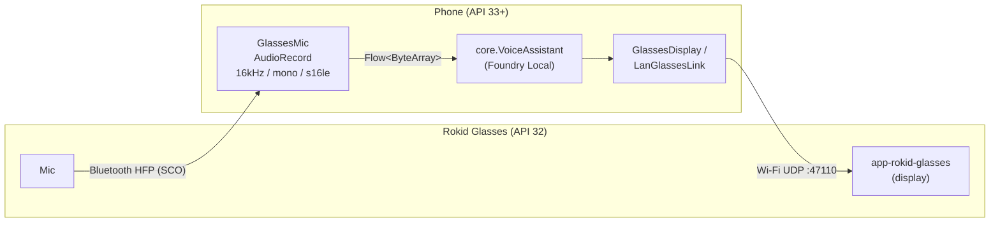

# app-rokid — Rokid Glasses (RV101)

English | [日本語](README.ja.md)

Rokid Glasses run Android 12 (API 32), which does not meet the minSdk 33 of Foundry Local for Android, and they have only 2 GB of RAM.
So inference runs on the phone, and the glasses handle only the microphone and the display.



| Module | Installed on | applicationId | Role |
|---|---|---|---|
| `app-rokid` | Phone | `com.example.flxr.rokid` (ipc adds `.ipc`) | Inference, audio input, sending display content to the glasses |
| `app-rokid-glasses` | Glasses | `com.example.flxr.rokid.glasses` | Displays the received text (minSdk 28 / targetSdk 32) |

## How it works

- **Microphone**: The glasses appear to the phone as a Bluetooth headset (HFP). The standard Android `AudioManager.setCommunicationDevice` switches input to SCO, and `AudioRecord` records 16 kHz PCM. The Rokid SDK is not used.
- **Display**: A small display app is installed on the glasses, and the phone sends text to it over Wi-Fi UDP. The phone finds the glasses via broadcast; if they are not found, you can enter the IP address manually.
- **Send rate**: Text is not sent per LLM token; the whole display content is sent at most once every 300 ms. It is also resent every 3 seconds even without changes, so a glasses app started later catches up. Each item is limited to its last 400 characters.

## Build

```powershell
.\gradlew.bat :app-rokid:assembleEmbeddedDebug :app-rokid:assembleIpcDebug :app-rokid-glasses:assembleDebug
```

| Output | Contents |
|---|---|
| `app-rokid/build/outputs/apk/embedded/debug/app-rokid-embedded-debug.apk` | Bundles the Foundry Local runtime |
| `app-rokid/build/outputs/apk/ipc/debug/app-rokid-ipc-debug.apk` | Uses the Foundry Local app from the Play Store |
| `app-rokid-glasses/build/outputs/apk/debug/app-rokid-glasses-debug.apk` | Display app to install on the glasses |

## Usage

### Setup

1. Pair the phone and glasses over Bluetooth (the normal initial setup in the Hi Rokid app is fine). In the phone's Bluetooth settings, make sure the glasses' "Phone calls" (通話音声) audio is ON.
2. Install `app-rokid-glasses-debug.apk` on the glasses. Transfer the APK to the phone and select it from "Toolbox" (ツールボックス) → "Glasses app management" (メガネのアプリ管理) in the Hi Rokid app.
3. Install the `app-rokid` APK on the phone. If you use the ipc build, also install the Foundry Local app from the Play Store.
4. Turn on Wi-Fi on the glasses and connect them to the same network as the phone (Wi-Fi on the glasses is OFF by default).

### Run

1. Launch **FLXR Glasses** on the glasses. `IP 192.168.x.x  UDP :47110` appears at the bottom of the screen.
2. Launch **FLXR Rokid** on the phone and grant the microphone and Nearby devices (Bluetooth) permissions.
3. Wait until the status under `3. Foundry Local` shows `準備完了` ("Ready"). The first run downloads the model.
4. Under `1. グラスとの接続` ("1. Connection to glasses"), tap `グラスを探す` ("Find glasses"). The connection is up when the status shows `CONNECTED`. If the glasses are not found, enter the IP address shown on the glasses screen and tap `設定` ("Set").
5. Tap `テスト表示` ("Test display") and confirm that text appears on the glasses.
6. Under `2. 音声の入力源` ("2. Audio input source"), select `グラスのマイク (BT)` ("Glasses mic (BT)"). It is ready when `BT SCO: <glasses name>` is shown.
7. Tap `● 話す` ("● Speak") and talk toward the glasses; the transcription and the reply appear on the glasses. Tap `■ 停止` ("■ Stop") to finish.

## Notes

- Audio over SCO has strong noise suppression and comes in at a very low level. For this reason the VAD minimum threshold is lowered to 40 (`vadMinThreshold`).
- SCO uses telephony-grade audio quality, so misrecognitions are more frequent than on other devices.
- On some phones, the `productName` of the SCO output device contains the phone's model name instead of the glasses'. The glasses' name is taken from the input device.
- On networks where broadcasts do not reach, such as tethering, enter the IP address manually.

## Files

| File | Contents |
|---|---|
| `MainActivity.kt` | UI and `RokidViewModel` (input source switching, connection to `VoiceAssistant`) |
| `GlassesMic.kt` | Glasses microphone (Bluetooth SCO) → `Flow<ByteArray>` (16kHz/mono/s16le) |
| `GlassesDisplay.kt` | Holds the display content and sends it with throttling |
| `GlassesProtocol.kt` | Message format between phone and glasses (keep in sync with `Receivers.kt` on the glasses side) |
| `LanGlassesLink.kt` | Discovery and sending over Wi-Fi (UDP) |
| `../app-rokid-glasses/` | Display app on the glasses (`GlassesActivity` / `UdpReceiver`) |
